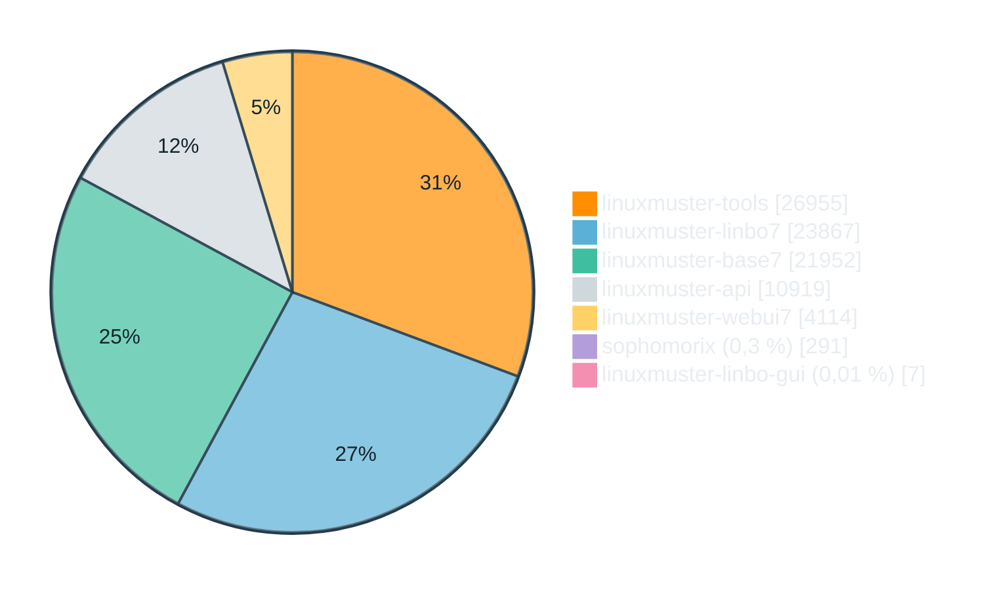

# linuxmuster.net 7.4

 Linux-Workshop - ZSL ES 19.10.2026

<div class="pt-6 opacity-70">Ubuntu 26.04 · OPNsense 26 · linuxmuster-base & -linbo 7.4</div>

<!--
Folien mit "DEMO" im Titel werden live gezeigt. Alle Demo-Befehle stehen im Slide-Text,
Vorbereitung siehe README.md (Testserver, Snapshot vor dem Workshop).
-->

---

# Agenda

<div class="grid grid-cols-1 gap-10">
<div>

1. Überblick und Zahlen
2. Upgrade auf 7.4
3. Setup und Servermanagement
   - Basis, Firewall-API, Zertifikate, Quota
4. Imaging und Clientmanagement
   - LINBO: Komponenten & Kernel, aria2c, Treiberprofile, linbo-remote
5. Betrieb und Fehlersuche
6. Zusammenfassung, Fragen

</div>
</div>

---
layout: section
---

# 1 · Überblick

---

# 7.4 in Zahlen <span class="text-2xl opacity-60">[Stand 15.10.2026]</span>

<div class="grid grid-cols-4 gap-4 text-center mt-4">
<div><div class="text-5xl font-bold">1.291</div>Commits</div>
<div><div class="text-5xl font-bold">121</div>Issues</div>
<div><div class="text-5xl font-bold">41</div>Pull Requests</div>
<div><div class="text-5xl font-bold">1.204</div>Dateien geändert</div>
</div>

<div class="grid grid-cols-2 gap-6 mt-6">
<div>

- Netto rund **37.000 neue Zeilen** (+95.027 / −57.781) in elf Repositories
- Größte Anteile: **tools** (27 k), **linbo7** (24 k), **base7** (22 k), **api** (11 k), **webui7** (4 k)
- Ein großes **Wartungs- und Modernisierungsrelease**
- **KI-Unterstützung** (Claude Code)

</div>
<div class="text-center">



</div>
</div>

<div class="text-xs opacity-60 mt-2">
Vergleich 7.4-Linie gegen 7.3-Linie ab Abzweigpunkt. Zeilen und Dateien ohne generierte Sphinx-Doku (tools, webui7) und shunit2 (linbo7).
</div>

<!-- Neu berechnet am 15.10.2026 nach docs/linuxmuster.net-74-stats.de.md (Stand dort: 22.09.2026).
Rohwerte inkl. generierter Doku: +204.655 / -107.662 Zeilen, 2.163 Dateien. -->

---

# Drei Themenbereiche

<div class="grid grid-cols-3 gap-6 mt-6">
<div class="p-4 border rounded">

### Upgrade 7.3 → 7.4
`linuxmuster-release-upgrade`

Nicht interaktives Distributionsupgrade und Migration der Konfiguration
</div>
<div class="p-4 border rounded">

### Setup und Servermanagement
`linuxmuster-base7`, `-common`, `-prepare`

Python-Neustruktur, Firewall per REST-API, Zertifikate, Quota
</div>
<div class="p-4 border rounded">

### Imaging und Clientmanagement
`linuxmuster-linbo7`

LinboFS, Kernel, aria2c, Windows-Treiberprofile, `linbo-remote`
</div>
</div>

---
layout: section
---

# 2 · Upgrade 7.3 → 7.4

---

# Voraussetzungen

- **OPNsense ≥ 26**, vorher aktualisieren
- Bestehende Firewallregeln **ins neue Format migriert** (OPNsense 26.1 Rule Migration)
- 7.3-Server **auf aktuellem Stand**, ggf. vorher rebooten
- Internetverbindung des Servers
- Umstieg von 7.3 auf 7.4 geht **nur zusammen mit Ubuntu 26.04**, weil sich die Paketstruktur grundlegend ändert
- Bestehende Konfiguration bleibt erhalten, wird ggf. migriert

<div class="mt-6 p-3 border-l-4 border-yellow-500 bg-yellow-500/10">
Vor dem Upgrade: <b>Snapshot</b> von Server und Firewall.
</div>

---

# Upgradeprozess

```bash
# als root auf der Serverkonsole, bei SSH in tmux
tmux new -s upgrade
linuxmuster-release-upgrade      # Sicherheitsabfrage mit "YES" bestätigen, oder per "--force" überspringen
# ... Kaffee holen ...
reboot
```

<v-clicks>

- prüft, ob Ubuntu 26.04 als Upgrade-Release verfügbar ist,
- stoppt LINBO-Imaging-Dienste `torrent` und `multicast`,
- prüft, ob Grub-Boot-Laufwerke hinterlegt sind, falls nicht, wird es abgefragt,
- entfernt störende Pakete (`modemmanager`, `cloud-init`),
- startet das Ubuntu-Release-Upgrade noninteraktiv (`DistUpgradeViewNonInteractive`),
- maskiert `isc-dhcp-server6`, deaktiviert `systemd-resolved` Stub-Listener
  und aktiviert `systemd-networkd-wait-online` Dienste,
- aktualisiert die linuxmuster.net-Pakete explizit, um Abhängigkeiten sauber aufzulösen (z.B. `dracut`),
- stellt Quota auf dem Root-Dateisystem auf das **interne ext4-Feature** um, andere Dateisysteme bleiben bei externen Quota-Dateien (Details: Folien „Quota“)

</v-clicks>

<!-- Das Upgrade dauert zu lang für live: vorbereiteten, bereits laufenden Lauf oder Log zeigen. -->

---

# Nach dem Upgrade prüfen

```bash
cat /etc/os-release | grep VERSION          # Ubuntu 26.04
dpkg -l | grep linuxmuster                  # 7.4.x
systemctl status isc-dhcp-server samba-ad-dc
linuxmuster-opnsense-apikey --check         # API-Key der Firewall gültig?
ls /var/log/linuxmuster/                    # Logs der Werkzeuge
```

<v-clicks depth="3">

- Migration der Konfiguration, wo nötig (Bestandsserver werden auf denselben Stand gebracht):
  - Fix-Skripte im `postinst` sind **idempotent**: 
    - `fix-cupsd.conf_189_190.sh`: Druckerfreigabe `@printing` ergänzt (#189), `/admin/conf` nur noch mit Anmeldung (#190)
    - `fix-systemd-resolved_203.sh`: hebt die Maskierung von `systemd-resolved` und `networkd-wait-online` auf, Stub-Listener per Drop-in aus (#203)
    - `fix-dhcpd-restart-on-failure_210.sh`: `isc-dhcp-server` startet bei Fehlschlag beim Boot neu (#210)
    - `fix-samba-interfaces_212.sh`: Samba registriert nur noch die Serveradresse im DNS (#212)

</v-clicks>

---
layout: section
---

# 3 · Setup und Servermanagement

---

# Neue Python-Basis

<v-clicks>

- Der gesamte Python-Code von **linuxmuster-base7** ist nach **Debian Python Policy** neu strukturiert
- `functions.py` wurde zum Paket `functions/` mit 8 Submodulen:

| Modul | Inhalt |
|---|---|
| `core`, `files` | Logging, setup.ini, Datei-I/O |
| `network` | Subnetze, Geräte-CSV, Validierung |
| `samba`, `linbo`, `certs` | AD-Helfer, LINBO/GRUB, Zertifikate |
| `remote`, `security` | Firewall-API / SSH, Passwörter |

- **Verbesserte Sicherheit:** Passwortdateien werden von Anfang an mit restriktiven Rechten angelegt, Shell-Aufrufe laufen ohne Shell (`subprocess.run()` mit Listenargumenten)
- Bestehende Importe bleiben gültig: `from linuxmuster_base7.functions import X`

</v-clicks>

---

# Firewall: REST-API statt SSH-Kommandos

<div class="grid grid-cols-2 gap-6">
<div>

### Neu in 7.4
- OPNsense wird über die **REST-API** angebunden
- Robuster als Kommandos über SSH
- Verständliche Fehlermeldung bei Auth-Fehlern (statt irreführender Versionsmeldung)
- Eingebaute Firewallregeln im **neuen UUID-Schema**: keine Migration nach Neuinstallation nötig
- Squid-Plugins in der Firmware-Liste korrekt registriert
</div>
<div>

### Weiterhin SSH/SCP
Die **Ersteinrichtung** (`m_firewall.py`) bleibt SCP-basiert, da es zu diesem Zeitpunkt noch keinen API-Key gibt, d.h. gepatchte Konfigration wird per SCP hochgeladen.

<div class="mt-4 text-sm opacity-70">
API basiert gilt daher für den laufenden Betrieb (Subnetze, Reset, Zertifikate), nicht für das Setup.
</div>
</div>
</div>

---

# API-Key prüfen und erneuern

Problem: **HTTP 401 „Authentication Failed"**, z. B. nach Wiederherstellen einer älteren Firewall-Sicherung.

```bash
linuxmuster-opnsense-apikey               # ohne Option: Hilfe
linuxmuster-opnsense-apikey --check       # nur den aktuellen Key testen
linuxmuster-opnsense-apikey --deploy      # neuen Key ausrollen, falls der aktuelle nicht geht
linuxmuster-opnsense-apikey --deploy --force   # Key in jedem Fall ersetzen
```

<v-clicks>

- Der Key wird per ssh auf der Firewall angelegt und in `firewall.api.ini` gespeichert
- Ablauf zeigen: Key auf der Firewall deaktivieren → `--check` schlägt fehl → `--deploy` → `--check` ok
- `linuxmuster-import-subnets` meldet Auth-Fehler jetzt klar

</v-clicks>

---

# Firewall-Reset und Subnetze

```bash
linuxmuster-opnsense-reset      # zurück in den Zustand nach dem Setup
linuxmuster-import-subnets      # Subnetze: DHCP, Routen, NAT, NTP
```

- `opnsense-reset` spielt die Default-Konfiguration ein, legt den **Kerberos-Keytab** neu an und wartet, bis die Firewall wieder da ist
- Neu: **Subnetze werden nach dem Reset automatisch neu importiert**. Statische Routen und Outbound-NAT für weitere Subnetze gingen vorher verloren.
- Keytab/SSO: Squid wird neu gestartet, *nachdem* der Keytab existiert
- `isValidHostIpv4()` prüft IP-Adressen jetzt **gegen ihr Subnetz** (#205)
  - Vorher: Adressen auf `.0` oder `.255` galten pauschal als Netz- bzw. Broadcastadresse, das stimmt nur bei /24
  - In `10.0.0.0/23` ist `10.0.0.255` eine normale Host-Adresse, wurde aber abgelehnt
  - In `10.0.0.0/26` ist `10.0.0.63` die Broadcastadresse, wurde aber akzeptiert
  - Jetzt: echte Netz- und Broadcastadresse aus der Präfixlänge berechnet, Adressen außerhalb des Subnetzes abgelehnt
  - Gilt für Server-, Firewall-IP und DHCP-Bereich im Setup sowie Router und DHCP-Bereich in `import-subnets`

---

# Zertifikate

<div class="grid grid-cols-2 gap-6">
<div>

- Neu erzeugte Zertifikate enthalten den **Subject Alternative Name**, wie ihn moderne Browser und Betriebssysteme erwarten
- **CA-Erneuerung repariert**: Sie brach mit openssl-Fehler ab bzw. installierte das neue Zertifikat nicht im System-Trust-Store
- CA-Erzeugung in gemeinsame Funktionen konsolidiert
- Dateinamen der Serverzertifikate nach **Servername**
</div>
<div>

### DEMO

```bash
openssl x509 -in /etc/linuxmuster/ssl/cacert.pem \
  -noout -ext subjectAltName

# CA, Server- und Firewall-Zertifikat
linuxmuster-renew-certs -c all
```

<div class="text-sm px-3 py-1 border rounded border-orange-400">

**Nie `-c ca` allein** auf von 7.3 aktualisierten Servern: Der Subject der CA ändert sich, Server- und Firewall-Zertifikat werden ungültig ([#216](https://github.com/linuxmuster/linuxmuster-base7/issues/216)).
</div>
</div>
</div>

<!-- -c ca allein ist nur bei einer CA aus 7.4 unkritisch (gleicher Schlüssel, gleicher Subject). Bei einer 7.3-CA enthält der Subject zusätzlich "subjectAltName=<realm>" und O ohne Anführungszeichen, die 7.4-Erneuerung baut ihn ohne diesen Teil und mit Anführungszeichen. -c all stellt Server und Firewall direkt nach der CA neu aus. Vor dem Workshop auf dem Testserver ausprobieren. -->

---

# Quota: zwei Verfahren in ext4

<div class="text-xs">

| | **extern** (bisher überall) | **intern** (neu in 7.4) |
|---|---|---|
| Quota-Daten | Dateien `aquota.user`, `aquota.group` im Dateisystem | versteckte Quota-Inodes, Feature `quota` im Superblock |
| Einschalten | nach jedem Boot `quotaon` (`quotaon@<mount>.service`) | automatisch durch den Kernel beim Einhängen |
| fstab in 7.3 | `usrjquota=aquota.user,grpjquota=aquota.group,jqfmt=vfsv0` | – |
| fstab in 7.4 | `usrquota,grpquota` | `usrquota,grpquota` |
| Kernel meldet | `Quota mode: writeback` | `Quota mode: journalled` |

</div>

<div class="grid grid-cols-2 gap-6 mt-5 text-xs">
<div class="qbox px-3 py-0 border rounded">

**Haken:** Das Feature setzt `tune2fs -O quota`, und das geht nur an einem **nicht eingehängten** Dateisystem. Root ist im laufenden Betrieb immer eingehängt.
</div>
<div class="qbox px-3 py-0 border rounded">

**Rolle von dracut:** Ubuntu 26.04 baut das initramfs mit **dracut** statt initramfs-tools. `linuxmuster-prepare` liefert das Modul `99linuxmuster`: Ein pre-mount-Hook ruft `tune2fs -O quota` vor dem Einhängen auf. dracut ist nur der **Weg**, nicht der Grund der Umstellung.
</div>
</div>

<style>
.qbox p { margin-top: 0.25rem; margin-bottom: 0.25rem; }
</style>

---

# Quota-Migration 7.3 → 7.4 mit LVM

<div class="grid grid-cols-2 gap-6 text-sm">
<div>

1. **`linuxmuster-release-upgrade`**: Ubuntu 26.04, dann linuxmuster-Pakete 7.4: `linuxmuster-base7` bringt **dracut**, `linuxmuster-prepare` das Modul `99linuxmuster`
2. **`e_fstab.py`** (vom Upgrade aufgerufen):
   - Root ohne Feature: initramfs neu bauen (`dracut --add linuxmuster`)
   - fstab: `usrjquota=`, `grpjquota=`, `jqfmt=` raus, `acl,usrquota,grpquota` rein
   - LVM-Volumes: bleiben extern, Quota neu aktiviert (`quotacheck`, `quotaon`), sofort oder nach dem Reboot
   - `quotaon-root`/`quotaon.service` maskiert, `quotaon@<mount>` nur bei Volumes mit Feature
3. **Reboot**: Der Hook setzt das Feature auf Root. Die Volumes in `vg_srv` sind im initramfs nicht aktiviert und damit unsichtbar.
</div>
<div class="mt-1">

<div class="font-bold">Ergebnis</div>

| Mount | Verfahren |
|---|---|
| `/` (`vda2`) | intern |
| `/var`, `/srv/linbo`, `/srv/samba/global`, `/srv/samba/schools/default-school` (`vg_srv`) | extern, `quotaon@….service` aktiv |

Quota ist überall aktiv, `systemctl --failed` ist leer.

```bash
tune2fs -l /dev/mapper/vg_srv-global | grep features
quotaon -pu /srv/samba/global
systemctl list-units 'quotaon@*'
journalctl -b -k | grep 'Quota mode'
```
</div>
</div>

<!-- Stand testserver2, 18.10.2026: Ubuntu 26.04.1, base7 7.4.24, prepare 7.4.2. Liegt Root selbst auf LVM, aktiviert das initramfs dieses Volume und Root bekommt das Feature trotzdem. -->

---

# Weitere Verbesserungen im Betrieb

- **NTP** (ntpsec): veraltete `notrap`/`nopeer` entfernt, saubere Erststarts ohne Fehler in `/var/log/ntpsec`
- **systemd-resolved** auf Samba-DCs: Reparatur für durch ältere Upgrades maskierte Units
- **SSH**: `dsa` aus den LINBO-Hostkey-Typen entfernt
- **cups**: Anpassung an aktuelle Version (#189)
- Firewall-Einrichtung: **NoProxy**-Alias korrigiert, Plugins `os-squid`, `os-web-proxy-sso`, `os-freeradius` werden korrekt registriert

---
layout: section
---

# 4 · Imaging und Clientmanagement

---

# LINBO: Basis überarbeitet

<div class="grid grid-cols-2 gap-6">
<div>

- Bauprozess nutzt jetzt komplett **reguläre Ubuntu-Pakete und -Komponenten**
- **Standard-Ubuntu-Kernel** statt selbst kompiliertem
- Torrent-Verteilung mit **aria2c** statt `ctorrent` (Details: nächste Folien)
- Hardwareerkennung über **systemd-udevd**
- **Erweiterbar:** Apps des Servers lassen sich per `harvest-app.sh` „ernten“ und über `update-linbofs`-Hooks ins `linbofs` einbauen (Demo folgt)
- Versionsschema: **4.3.x → 7.4.x**
</div>
<div>

### Warum?
Wartung und Absicherung werden deutlich einfacher, denn Kernel-Updates, Firmware und Module kommen aus der Distribution.

<div class="mt-4 text-sm opacity-70">
Der vorkompilierte Kernel-Pfad (4.3) wird nicht auf 7.4 portiert.
</div>
</div>
</div>

---

# aria2c: globale Optionen

`/etc/default/linbo-torrent`

<div class="text-sm">

| Option | Bedeutung |
|---|---|
| **`ARIA2C_GLOBAL_OPTS`** | *immer, beim Laden und Seeden* |
| `--enable-color=false` | keine Farbcodes in Konsole und Log |
| `--enable-dht=false` | kein DHT¹, Peers nur über Tracker und LPD² |
| `--disable-ipv6=true` | nur IPv4 |
| `--bt-enable-lpd=true` | **neu:** Peers im selben Segment per Multicast finden (LPD²) |
| `--bt-tracker-interval=300` | **neu:** alle 5 statt 30 Minuten beim Tracker melden |

</div>

<div class="text-xs opacity-70 mt-6">

¹ DHT: *Distributed Hash Table*, trackerlose Peer-Suche übers Internet<br>
² LPD: *Local Peer Discovery*, Peer-Suche per Multicast im lokalen Netzsegment
</div>

---

# aria2c: Download- und Seed-Optionen

<div class="grid grid-cols-5 gap-6 text-xs">
<div class="col-span-3 optab">

| Option | Bedeutung |
|---|---|
| **`ARIA2C_DWNLD_OPTS`** | *Client lädt ein Image* |
| `-c` | abgebrochenen Download fortsetzen |
| `--console-log-level=notice` | nur Meldungen ab „notice“ ausgeben |
| `--show-console-readout=true`<br>`--summary-interval=3` | Fortschrittszeile, alle 3 Sekunden eine Zusammenfassung |
| `--seed-time=0` | nach dem Download beenden, danach seedet `linbo_seeder` |
| **`ARIA2C_SEED_OPTS`** | *Server und Clients seeden* |
| `-V` | vorhandene Datei gegen den Torrent prüfen, dann seeden ohne Download |
| `--seed-ratio=0.0` | unbegrenzt seeden, unabhängig vom Verhältnis Upload zu Download |

</div>
<div class="col-span-2">

### Wer nutzt was?

| Rolle | Optionen | gestartet von |
|---|---|---|
| Server seedet | GLOBAL + SEED | `linbo-torrent` (tmux, als `nobody`) |
| Client lädt | GLOBAL + DWNLD | `linbo_download_image` |
| Client seedet | GLOBAL + SEED | `linbo_seeder` (tmux) |
</div>
</div>

<style>
.optab td:first-child { white-space: nowrap; }
</style>

---

# DEMO · aria2c-Seeder beobachten

<div class="grid grid-cols-2 gap-6 text-sm" style="--slidev-code-font-size: 11px; --slidev-code-line-height: 1.4">
<div>

### Server
```text
# linbo-torrent status
debian_qcow2_torrent: 1 windows (created Sun Oct 18 12:46:34 2026)
debian_qdiff_torrent: 1 windows (created Sun Oct 18 12:46:36 2026)
win11_qcow2_torrent: 1 windows (created Sun Oct 18 12:46:33 2026)
...

# ps -o user,args -C aria2c
nobody  /usr/bin/aria2c --enable-color=false --enable-dht=false
        --disable-ipv6=true --bt-enable-lpd=true
        --bt-tracker-interval=300 -V --seed-ratio=0.0
        debian.qcow2.torrent

# linbo-torrent attach debian.qcow2
[NOTICE] Überprüfung erfolgreich abgeschlossen.
         Datei=/srv/linbo/images/debian/debian.qcow2
[NOTICE] IPv4 BitTorrent: Lauschen am TCP-Port 6960
[#0b1374 SEED(1.0) CN:0 SD:0 UL:119MiB(2.1GiB)]
FILE: /srv/linbo/images/debian/debian.qcow2
```
Lösen mit [CTRL+B]+[D]
</div>
<div>

### Client
```text
# linbo-ssh multi-1
# tmux ls
debian_qcow2_torrent: 1 windows (created Sun Oct 18 14:16:27 2026)
debian_qdiff_torrent: 1 windows (created Sun Oct 18 14:16:43 2026)
win11_qcow2_torrent: 1 windows (created Sun Oct 18 14:16:12 2026)

# tmux attach -t debian_qcow2_torrent
[NOTICE] Downloading 1 item(s)
[#a61245 0B/2.1GiB(0%) CN:0 SD:0 DL:0B]
  [Checksum:#a61245 1.7GiB/2.1GiB(82%)]
[NOTICE] Überprüfung erfolgreich abgeschlossen.
         Datei=/cache/debian.qcow2
[#a61245 SEED(0.0) CN:0 SD:0]
FILE: /cache/debian.qcow2
```

**Lesehilfe:** `0B/2.1GiB(0%)` geladen/Gesamtgröße · `DL` Download-Rate · `Checksum` Prüfung der vorhandenen Datei (`-V`) · `SEED(1.0)` Verhältnis Upload zu Dateigröße · `CN` Verbindungen · `SD` Seeder · `UL` Upload-Rate (gesamt)
</div>
</div>

<!-- Ausgaben von testserver1 und client1, 18.10.2026. -->

---

# opentracker, Hashdateien und Torrent-Werkzeuge

<div class="grid grid-cols-2 gap-6 text-sm">
<div>

### Neu: Hashdateien
- Zu jedem Torrent legt `linbo-torrent` eine Datei **`<image>.hash`** mit dem Info-Hash an, z. B. `ubuntu.qcow2.hash`
- Der Client lädt die Hashdatei vom Server und vergleicht sie mit dem Hash seiner lokalen `.torrent`-Datei
- Weichen sie ab, lädt der Client das **neue Image** herunter

### Neu: Whitelist
- `/srv/linbo/images/opentracker/torrent.whitelist` enthält alle Info-Hashes aus den `*.hash`-Dateien
- opentracker bedient **nur diese Torrents** (`access.whitelist` in `opentracker.conf`)
- Aktualisiert bei `linbo-torrent start|restart|create` oder mit `linbo-torrent update-otr`
</div>
<div>

### Neu: `buildtorrent` und `btcheck`

| Aufgabe | 7.3 (`ctorrent`) | 7.4 |
|---|---|---|
| Torrent erzeugen | `ctorrent -t -u <url> -s <torrent> <image>` | `buildtorrent --announce <url> <image> <torrent>` |
| Torrent prüfen | `ctorrent -c <torrent>` | `btcheck -v <torrent>` |
| Info-Hash lesen | – | `btcheck -ni <torrent>` |

`<url>` = `http://<serverip>:6969/announce`

Im Alltag reichen die Wrapper:
```bash
linbo-torrent create ubuntu.qcow2
linbo-torrent check ubuntu.qcow2
```
</div>
</div>

---

# DEMO · linbofs um eine App erweitern

Beispiel: `/usr/bin/fwupdtool` (Firmware-Werkzeug aus dem Paket `fwupd`) auf die Clients bringen

<div class="grid grid-cols-3 gap-4 text-sm" style="--slidev-code-font-size: 11px; --slidev-code-line-height: 1.4">
<div>

### 1 · Installieren und ernten
```bash
apt-get install fwupd

/usr/share/linuxmuster/linbo/harvest-app.sh \
  /usr/bin/fwupdtool \
  /etc/fwupd /usr/share/fwupd
```
Bibliotheken werden per `ldd` ermittelt, schon vorhandene ausgelassen. Ergebnis: `fwupdtool.tar.xz` in `/var/cache/linuxmuster/linbo/apps/`, weitere Argumente werden mitgepackt.
</div>
<div>

### 2 · Hook anlegen
```bash
# .../hooks/update-linbofs.pre.d/10_fwupdtool
#!/bin/bash
tar --keep-directory-symlink -xf \
  /var/cache/linuxmuster/linbo/apps/fwupdtool.tar.xz
```
```bash
chmod +x /var/lib/linuxmuster/hooks/\
  update-linbofs.pre.d/10_fwupdtool
```
Der Hook läuft im Wurzelverzeichnis des `linbofs` und muss **ausführbar** sein.
</div>
<div>

### 3 · Einbauen und prüfen
```bash
update-linbofs
# Ausgabe: "Executing pre hookfile ..."

# Client neu starten, in LINBO
# per Konsole:
fwupdtool get-devices
```
</div>
</div>

---

# linbo-remote und `--dry-run`

`linbo-remote` ist komplett in **Python** neu geschrieben, gleicher äußerer Aufruf.

```bash
linbo-remote -i r100-pc01 -c reboot --dry-run     # zeigt nur, was passieren würde
linbo-remote -i r100-pc01 -c reboot               # führt aus
```

<v-clicks>

- WOL wird über **Samba AD** aufgelöst
- Ein Logfile **pro Lauf**: `<host>_linbo-remote_<YYYYmmddHHMMSS>.log`, alte Logs werden aufgeräumt
- JSON-Laufprotokoll: `linbo-remote_runs.jsonl` im LINBO-Logverzeichnis
- Exit-Code bei Abbruch durch Signal: 128 + Signal
- `--dry-run` verlangt `-c` oder `-p`

</v-clicks>

---

# Windows-Treiberprofile (in Entwicklung)

- LINBO ordnet Windows-Treiber **anhand der Hardware-Kennung** jedes Clients automatisch zu und verteilt sie, **ohne zusätzlichen Dienst oder Netzwerk-Port**
- Profile werden über die **API** oder im **Dateisystem** angelegt und Images zugewiesen
- Stand: grundlegend implementiert, Bedienung noch spartanisch, **keine** Oberfläche in WebUI und CLI

<div class="mt-4 p-3 border-l-4 border-yellow-500 bg-yellow-500/10">
Einmalige Vorbereitung am <b>Muster-Client</b> und anschließende Neuerstellung des Images nötig. Ohne sie werden Treiber erst bei der nächsten Anmeldung eines Administrators installiert.
</div>

Anleitung: `docs/windows-treiberprofile-einrichten.de.md` im Repository linuxmuster-linbo7

---

# Verbesserungen im Client-Betrieb

<div class="text-sm">

<v-clicks>

- **WLAN in LINBO** zuverlässiger, z. B.:
  - Intel-WLAN: Firmware liegt unter `/lib/firmware/intel/iwlwifi/`, der Kernel sucht sie über einen Link in `/lib/firmware/`. `update-linbofs` legt den Link jetzt mit an (#164).
  - WPA2: Modul `ccm` (AES-Verschlüsselung) fehlte, Verbindung brach mit `key addition failed` ab (#150)
  - Fehlende Firmware wird über die Kernel-Meldung `Direct firmware load for … failed` erkannt (#154), aus der Firmware-Liste entfernte Einträge verschwinden wieder (#153)
- **USB-Netzwerkadapter**, z. B. RTL8153 (#167): Die Netzwerkkarte ers.cheint erst einige Sekunden nach dem Start, LINBO fand noch keine und blieb offline. Jetzt wartet LINBO bis zu 10 Sekunden auf eine Netzwerkschnittstelle, einstellbar mit dem Kernelparameter `netwait=<n>`.
- `init.sh` hängt nicht mehr in `udhcpc` (#187): Auf einer Netzwerkschnittstelle, die nicht aktiv war, wiederholte `udhcpc` endlos `Network is down`, LINBO kam nie über „Requesting ip address per dhcp“ hinaus. Jetzt wird die Schnittstelle übersprungen, `udhcpc` nach spätestens `dhcpretry` × 4 + 5 Sekunden abgebrochen.
- **Cache-Partition** auch ohne `by-id`-Links (#189): Beim Start ohne Server sucht LINBO den Cache über `/dev/disk/by-id`. Fehlen dort Links (virtio-Disk ohne Seriennummer, manche eMMC- und USB-Geräte), fand es nichts und landete im Fernsteuermodus. Jetzt sucht es zusätzlich in allen Partitionen, die der Kernel kennt.

</v-clicks>

</div>

---

# Verbesserungen auf dem LINBO-Server

<div class="text-sm">

<v-clicks>

- **Maschinen-Account-Dateien** nur noch root-lesbar (#182): `*.macct` enthalten die Passwort-Hashes des Maschinenkontos. `linbo-torrent` gab Kopien in `backups/` und `.incoming/` an `nobody`, und das rsync-Modul `[linbo]` liefert als `nobody` ohne Anmeldung aus. Damit waren sie für jeden im Netz abrufbar. Jetzt immer `root:root` mit Rechten `600`.
- `linbo-torrent` und `linbo-multicast` **beenden keine fremden tmux-Sessions** mehr: Ein Neustart der Dienste beendete alle tmux-Sessions des Servers, auch die, in der gerade `linuxmuster-release-upgrade` lief. Jetzt trifft der Neustart nur noch die eigenen Prozesse.
- **Parallele Status- und Log-Uploads** (#172): Alle Clients nutzten dieselbe Zwischendatei in `/srv/linbo/tmp`. Luden zwei gleichzeitig hoch, landeten Daten im Log des falschen Rechners. Jetzt hat jede Übertragung ihre eigene Zwischendatei.
- **GRUB-Images in Multi-Schul-Umgebungen** (#178): `import-devices` trägt Rechner anderer Schulen mit dem Schulnamen als Präfix in DHCP und hostcfg ein, z. B. `gsnord-pc01`. `linbo-mkgrubimg` kannte das nicht, legte das Image unter dem falschen Namen an, und `--setfilename` änderte nichts. Jetzt mit Präfix.

</v-clicks>

</div>

---
layout: section
---

# 6 · Betrieb und Fehlersuche

---

# Logs und Werkzeuge

<div class="text-sm logtab">

| Was | Wo |
|---|---|
| Setup-Module | `/var/log/linuxmuster/setup.<modul>.log` |
| Geräteimport | `/var/log/linuxmuster/import-devices.log` |
| Subnetzimport | `/var/log/linuxmuster/import-subnets.log` |
| Zertifikate | `/var/log/linuxmuster/renew-certs.log` |
| `linbo-remote` | `<host>_linbo-remote_<ts>.log` + `linbo-remote_runs.jsonl` |

<div class="font-bold mt-4">Typische Symptome nach dem Upgrade</div>

| Symptom | Maßnahme |
|---|---|
| HTTP 401 von der Firewall | `linuxmuster-opnsense-apikey --check` / `--deploy` |
| Statische Routen/NAT weg | `linuxmuster-import-subnets` |
| dhcpd nach Boot nicht aktiv | `systemctl status isc-dhcp-server`: postinst-Fix prüfen |
| Zertifikatswarnung im Browser | SAN prüfen, `linuxmuster-renew-certs` |

</div>

<style>
.logtab td, .logtab th { padding-top: 0.35rem; padding-bottom: 0.35rem; }
</style>

---
layout: section
---

# 7 · Zusammenfassung

---

# Das Wichtigste auf einer Folie

<v-clicks>

1. **Ubuntu 26.04**-Basis, Umstieg nur gemeinsam mit dem Upgrade (`linuxmuster-release-upgrade`)
2. **OPNsense ≥ 26** und migrierte Regeln als Voraussetzung
3. Firewall im Betrieb per **REST-API**, neues Werkzeug `linuxmuster-opnsense-apikey`
4. **Zertifikate**: SAN, CA-Erneuerung repariert
5. Dateisystem-Quota im **journalled** oder **writeback** Mode
6. LINBO: **Ubuntu-Kernel, aria2c**, Version **7.4.x**, `linbo-remote` in Python mit `--dry-run`
7. **Windows-Treiberprofile** (in Entwicklung)

</v-clicks>

---

# Ressourcen und Fragen

- Release Notes: `docs/release-notes-linuxmuster.net-74.de.md` (base7)
- Upgrade-Anleitung: `docs/upgrade-26.04.de.md`
- Dokumentation: https://docs.linuxmuster.net
- Forum: https://ask.linuxmuster.net
- Quellcode: https://github.com/linuxmuster

<div class="mt-10 text-3xl">Fragen?</div>
